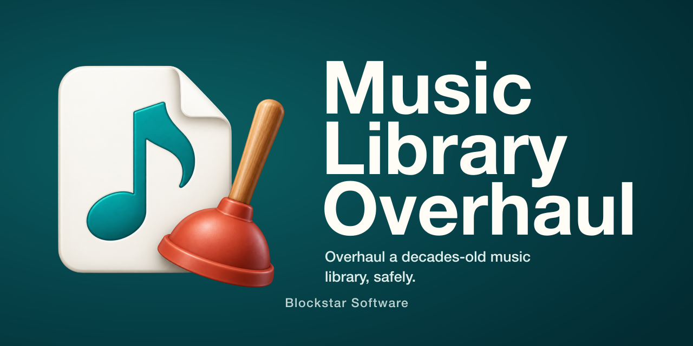

# Music Library Overhaul



A skill for coding agents (Claude Code and Codex) for honing a large personal
music library down to a lossless, high-quality collection of music you
actually care about. Over the years we import albums, find downloads and
gather music from all kinds of sources that seemed worth having at the time
and that we're now clear we don't want. Those libraries are also full of
mixed MP3 and lossless files, messy or missing tags, duplicate albums,
"lossless" albums hiding lossy tracks, truncated or corrupt files, live
bootlegs, spoken word and videos mixed in, and a long tail of stray singles.

Your agent walks you through it phase by phase, explaining each step before
it happens, and does the heavy lifting with the bundled scripts. You make the
decisions: what to keep locally, what to trade for streaming playlists, what
to let go.

**Read [How it works](HOW-IT-WORKS.md) for the whole process, step by step,
before you start.**

It was distilled from a real cleanup of a 17,000-track, 550 GB library over
several sessions, including the mistakes, so the scripts carry the fixes.

## Before anything else: back up

The process moves, renames, retags, converts and removes files in bulk.
**Make a full backup of your library, leave it untouched, and point the agent at
a copy.** Nothing in the toolkit hard-deletes (removals go to a recoverable trash
with a restore command), but a backup is the real safety net. You should be
comfortable managing files and folders; if you're unsure, try a small test
batch first.

## What it does

| Phase | What happens | Script |
|---|---|---|
| 0. Integrity scan | Finds truncated, empty, unreadable and mislabeled files. Decodes every MP3, FLAC and WAV, the only reliable way to catch a truncated one. Repairs lying MP3 headers and mangled extensions losslessly. | `scan_integrity.py`, `repair.py` |
| 1. Live recordings | Inventories show folders, parses dates from messy names, guesses the source, and plans tags in the form `YYYY.MM.DD Venue, City, ST \| Source`. | `plan_shows.py` |
| 2. Cull the long tail | One spreadsheet row per artist (and per compilation); you type K (keep), D (delete), S (stream instead), U (upgrade) or B (both local and streaming). | `cull_sheet.py` |
| 3. Streaming playlists | Import-ready playlists for Spotify and other services, via TuneMyMusic or Soundiiz, for what you'd rather stream than store. | `streaming_csv.py` |
| 4. Deep clean | Finds false-lossless albums, lossy duplicates, redundant album copies (keeping remasters), and artists split by spelling. | `audit_codecs.py`, `find_duplicates.py`, `find_split_artists.py` |
| 5. Non-music | Finds lectures, audiobooks, podcasts and personal recordings, without flagging DJ mixes or symphonies. | `find_nonmusic.py` |
| 6. "Unknown Artist" | Files with empty tags get real tags from their filenames and go to their artist folders. | `retag.py` |
| 7. Videos | Separates real music videos from songs in video containers and cover-art-only files, and rewraps the latter to audio. | `probe_videos.py` |
| 8. Formats | Converts WAV/AIFF to ALAC or FLAC, proving each conversion lossless by checksum; flags DRM files. | `convert_lossless.py` |
| 9. Merge and final check | Merging tiers back together exposes same-artist folder pairs and hidden duplicates; a last full scan is the gate. | `find_split_artists.py`, `find_duplicates.py`, `scan_integrity.py` |
| Throughout | Safe in-place retagging (temp in the same folder, verify, atomic swap), a refusal to silently drop tags ffmpeg can't carry (gapless info, ratings, MusicBrainz IDs), and a recoverable trash. | `retag.py`, `trash.py` |

Every script that changes files does nothing without `--apply`, so you see
what would happen first.

## What a run looks like

The integrity scan on a library with problems planted in it:

```
$ python3 scripts/scan_integrity.py library
Scanned 42 files under library
  ok: 37
  length_mismatch: 1
  zero_byte: 1
  truncated: 1
  wrong_extension: 1
  drm: 1
ERROR length_mismatch: Linkin Park/Hybrid Theory/Crawling.mp3  header claims 6.0s, audio decodes to 3.0s. ...
ERROR zero_byte: Odd Files/empty.mp3  empty file
ERROR truncated: Tedeschi Trucks Band/2019.04.14 RuhrCongress/2-09 I Want More.m4a  mdat atom runs past end of file
WARN wrong_extension: Odd Files/track.m  file is really mp3; rename to .mp3 (repair.py extensions)
```

Lossy leftovers inside a lossless album, told apart from a live take of the same song:

```
$ python3 scripts/find_duplicates.py mixed library
duplicate of lossless track: The Black Crowes/Amorica/A Conspiracy (single).m4a  [trash lossy copy]
different version: The Black Crowes/Amorica/Wiser Time (Live).mp3  [keep; listen to confirm]
duplicate of lossless track: The Black Crowes/Amorica/Wiser Tyme.mp3  [trash lossy copy]
```

Nothing is removed until you say so, and everything removed can be restored.

## Requirements

- macOS, Linux or another system with **ffmpeg and ffprobe** on the PATH. On a
  Mac: `brew install ffmpeg` (Homebrew).
- **Python 3.9 or later**, standard library only. The Python that comes with
  Apple's Command Line Tools works.
- A coding agent that runs commands on your files: **Claude Code** or
  **Codex**. Chat apps such as claude.ai or ChatGPT can't reach a library on
  your disk.

## Install

**Claude Code:**

```bash
git clone https://github.com/blockstarsoftware/music-library-overhaul.git ~/.claude/skills/music-library-overhaul
```

**Codex:**

```bash
git clone https://github.com/blockstarsoftware/music-library-overhaul.git ~/.agents/skills/music-library-overhaul
```

Codex runs commands in a sandbox and may ask before writing outside its
working folder, so start it in the folder that holds your library copy.

Then ask your agent something like *"Help me clean up my music library, the copy is
in ~/Music/Library Copy."*

## Try it safely first

The tests build a small fake library out of generated tones, with every
problem the skill handles planted in it. You can build one to experiment on:

```bash
python3 tests/fixtures.py /tmp/demo-library
python3 scripts/scan_integrity.py /tmp/demo-library/library
```

Run the test suite (31 tests, about 20 seconds):

```bash
python3 tests/test_scripts.py
```

## License

MIT. Copyright (c) 2026 Eli Block. See [LICENSE](LICENSE).

Blockstar Software · [blockstarsoftware.com](https://blockstarsoftware.com)
